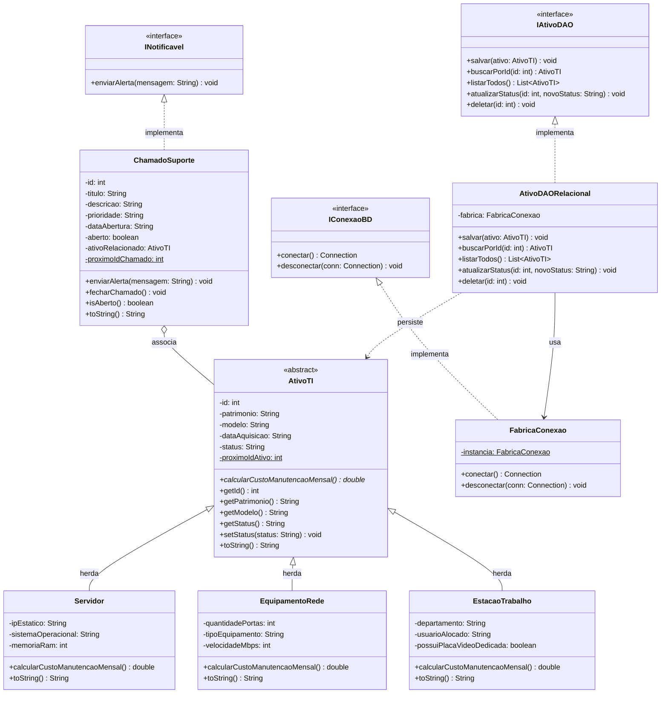

# 💻 TechLab Inventory & Service Desk

> **Projeto Prático da Disciplina:** Programação Orientada a Objetos & Persistência (2026.2)  
> **Instituição:** Faculdade SENAC Ceará — Graduação em Análise e Desenvolvimento de Sistemas  
> **Professor:** Me. Tibério Bezerra Soares  
> **Desenvolvedor / Aluno:** Jeronimo Silva (`shaolin.jr@gmail.com`)  

---

## 📌 Sobre o Projeto

O **TechLab Inventory & Service Desk** é um sistema corporativo em Java desenvolvido para gerenciar o inventário de ativos de infraestrutura de TI de um laboratório/empresa e automatizar o controle de chamados técnicos de suporte.

O foco central deste software é a aplicação rigorosa dos **4 Pilares da Programação Orientada a Objetos (POO)** combinados com boas práticas de engenharia de software (Clean Code, Validação Defensiva de Entrada, Desacoplamento via Interfaces e Padrão DAO com JDBC/PreparedStatements).

---

## 🏛️ Pilares da POO e Arquitetura de Software

### 1. 🔒 Encapsulamento Rígido & Validação Defensiva
* Todos os atributos de estado das entidades são estritamente `private` (ex: `patrimonio`, `modelo`, `status`, `ipEstatico`, `usuarioAlocado`).
* O acesso é mediado exclusivamente por **Getters** e **Setters**.
* A camada de apresentação (`Main`) implementa métodos blindados de leitura que tratam exceções (`NumberFormatException`), impedindo crash da aplicação por digitação errada:
  * **Rejeição de números em texto:** Campos como `departamento` e `usuarioAlocado` usam regex que proíbem dígitos numéricos (`^[A-Za-zÀ-ÖØ-öø-ÿ\\s\\-]+$`).
  * **Validação de IP:** Endereços IPv4 são validados estritamente no formato `xxx.xxx.xxx.xxx`.
  * **Validação de Datas:** Datas são exigidas no padrão ISO `AAAA-MM-DD`.
  * **Booleanos Flexíveis:** Entradas como GPU dedicada aceitam amigavelmente `S`, `N`, `Sim`, `Não`, `1`, `0`.

### 2. 🌲 Herança & Especialização
* A superclasse abstrata `AtivoTI` consolida os atributos universais de qualquer equipamento de tecnologia (ID único sequencial automático, Patrimônio, Modelo, Data de Aquisição e Status).
* Três subclasses especializam o domínio com atributos e regras específicas:
  * **`Servidor`**: Especializado com `ipEstatico`, `sistemaOperacional` e `memoriaRam` (em GB).
  * **`EquipamentoRede`**: Especializado com `quantidadePortas`, `tipoEquipamento` (*Switch*, *Roteador*, *Firewall*) e `velocidadeMbps`.
  * **`EstacaoTrabalho`**: Especializada com `departamento`, `usuarioAlocado` e `possuiPlacaVideoDedicada`.

### 3. 🎭 Polimorfismo Dinâmico
* A classe base declara o método abstrato:
  ```java
  public abstract double calcularCustoManutencaoMensal();
  ```
* Cada subclasse implementa sua própria regra de negócio corporativa para apuração de custos operacionais:
  * **Servidor:** Taxa base de Data Center (R$ 250,00) + R$ 25,00 por GB de memória RAM.
  * **Equipamento de Rede:** Taxa fixa de rack (R$ 120,00) + R$ 8,00 por porta física instalada.
  * **Estação de Trabalho:** Suporte N1 base (R$ 80,00) + R$ 40,00 adicionais para máquinas com GPU dedicada.
* No inventário, a chamada polimórfica `ativo.calcularCustoManutencaoMensal()` invoca a lógica exata do objeto em tempo de execução sem necessidade de casting ou `instanceof`.

### 4. 🧩 Interfaces, Desacoplamento & Padrão DAO
* **`INotificavel`:** Define o comportamento obrigatório de envio de alertas de incidentes no Service Desk.
* **`IConexaoBD`:** Desacopla a fábrica de conexão JDBC (`FabricaConexao`) para permitir migração entre SQLite, MySQL ou PostgreSQL sem alterar o código de negócio.
* **`IAtivoDAO`:** Define o contrato completo de operações CRUD (`salvar`, `buscarPorId`, `listarTodos`, `atualizarStatus`, `deletar`).
* **`AtivoDAORelacional`:** Implementa o acesso ao banco com `PreparedStatement` para proteção contra SQL Injection e reconstrói as subclasses exatas via polimorfismo.

---

## 📊 Diagrama de Classes e Arquitetura (Mermaid)



---

## 📂 Estrutura do Repositório

```text
techlab-inventory/
├── README.md                               # Documentação executiva completa
├── .gitignore                              # Filtro de binários, jars e logs
├── GUIA_OFICIAL_PROFESSOR_TIBERIO.md        # Calendário e escopo pedagógico
├── TECHLAB_MASTER_SPEC_ZED_GEMINI.md        # Especificação arquitetural do projeto
├── database/
│   └── schema.sql                          # DDL relacional (tabelas ativos e chamados)
└── src/
    └── techlab/
        ├── app/
        │   └── Main.java                   # Menu interativo, validações e console
        ├── dao/
        │   └── AtivoDAORelacional.java     # Implementação CRUD com PreparedStatement
        ├── database/
        │   └── FabricaConexao.java         # Conexão JDBC Singleton (SQLite/MySQL)
        ├── exception/
        │   ├── EquipamentoNaoEncontradoException.java
        │   └── FalhaConexaoBDException.java
        ├── interfaces/
        │   ├── IAtivoDAO.java              # Contrato CRUD de persistência
        │   ├── IConexaoBD.java             # Contrato de infraestrutura JDBC
        │   └── INotificavel.java           # Contrato de mensageria de incidentes
        └── model/
            ├── AtivoTI.java                # Superclasse abstrata com ID automático
            ├── ChamadoSuporte.java         # Associação e Service Desk
            ├── EquipamentoRede.java        # Subclasse de infra de rede
            ├── EstacaoTrabalho.java        # Subclasse de desktop de usuário
            └── Servidor.java               # Subclasse de servidor/datacenter
```

---

## 🚀 Como Compilar e Executar

### Pré-requisitos
* Java Development Kit (JDK) versão 17 ou superior.
* `javac` e `java` disponíveis no terminal.

### Passo 1: Compilar as Classes
No Linux / macOS:
```bash
mkdir -p bin
javac -encoding UTF-8 -d bin $(find src -name "*.java")
```

No Windows (PowerShell):
```powershell
New-Item -ItemType Directory -Force bin
javac -encoding UTF-8 -d bin (Get-ChildItem -Path "src" -Recurse -Filter *.java).FullName
```

### Passo 2: Executar a Aplicação
```bash
java -cp bin techlab.app.Main
```

> *(Opcional)* Para habilitar a gravação física no banco SQLite, adicione o driver `sqlite-jdbc.jar` ao classpath:
> ```bash
> java -cp "bin;lib/sqlite-jdbc.jar" techlab.app.Main
> ```

---

## 🕹️ Recursos do Menu Interativo

1. **Cadastrar Novo Ativo de TI:** Validação defensiva completa (IP formatado, sem números em departamentos, datas no padrão ISO e confirmação de persistência via DAO).
2. **Listar Inventário:** Demonstração do **Polimorfismo Dinâmico** calculando o custo de manutenção individual e global.
3. **Abrir Chamado de Suporte:** Associação com equipamento físico e disparo de alerta via interface `INotificavel`.
4. **Fechar Chamado de Suporte:** Atualiza status do ticket.
5. **Listar Chamados de Suporte:** Histórico completo de ocorrências.
6. **Carregar Dados de Demonstração (Carga Rápida):** Popula o sistema com 3 ativos e 2 chamados em 1 clique para apresentações rápidas ao professor.
7. **Consultar Banco de Dados SQLite:** Demonstração da camada DAO executando `SELECT` relacional.
0. **Sair do Sistema.**

---

## 📝 Licença & Autoria
Desenvolvido por **Jeronimo Silva** para a disciplina de **Programação Orientada a Objetos & Persistência (2026.2)** da Faculdade SENAC Ceará sob orientação do **Prof. Me. Tibério Bezerra Soares**.
