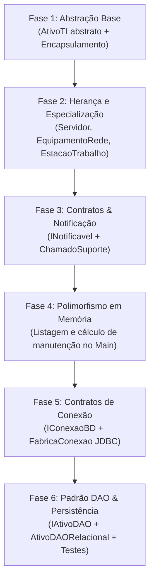

# 🛠️ TechLab Inventory & Service Desk — Master Spec & Blueprint (Zed + Gemini)

> **Documento de Contexto Oficial:** Utilize este arquivo como referência mestre no editor **Zed** conectado ao **Gemini**.  
> **Disciplina:** Programação Orientada a Objetos & Persistência | **Faculdade SENAC Ceará**  
> **Professor:** Me. Tibério Bezerra Soares | **Aluno:** Jeronimo Silva  
> **Objetivo:** Guia arquitetural rigoroso para implementação incremental em sala de aula, respeitando 100% dos princípios de POO clássica e persistência relacional (JDBC/DAO).

---

## 🏛️ 1. Arquitetura de Pacotes do Projeto

Para manter a separação estrita de responsabilidades, utilize a estrutura modular de pacotes:

```text
TechLab_Inventory/
├── GUIA_OFICIAL_PROFESSOR_TIBERIO.md
├── TECHLAB_MASTER_SPEC_ZED_GEMINI.md
├── database/
│   └── schema.sql                          # Script de criação de tabelas (SQLite/MySQL)
└── src/
    └── techlab/
        ├── model/                          # Entidades de Domínio e Herança
        │   ├── AtivoTI.java                # Superclasse Abstrata Base
        │   ├── Servidor.java               # Subclasse Especializada
        │   ├── EquipamentoRede.java        # Subclasse Especializada
        │   ├── EstacaoTrabalho.java        # Subclasse Especializada
        │   └── ChamadoSuporte.java         # Entidade de Negócio (Associação c/ AtivoTI)
        ├── interfaces/                     # Contratos de Software
        │   ├── INotificavel.java           # Interface de Notificações / Alertas
        │   ├── IConexaoBD.java             # Interface Desacoplada de Conexão com BD
        │   └── IAtivoDAO.java              # Interface CRUD de Persistência (Padrão DAO)
        ├── database/                       # Infraestrutura de Conexão Relacional
        │   └── FabricaConexao.java         # Gerenciador de Driver JDBC (SQLite / MySQL)
        ├── dao/                            # Implementação de Acesso aos Dados
        │   └── AtivoDAORelacional.java     # Implementação concreta com PreparedStatement
        ├── exception/                      # Robustez e Exceções Customizadas
        │   ├── EquipamentoNaoEncontradoException.java
        │   └── FalhaConexaoBDException.java
        └── app/                            # Ponto de Entrada da Aplicação
            └── Main.java                   # Demonstração Incremental e Polimorfismo
```

---

## 📐 2. Especificação Detalhada das Classes & Interfaces

### 2.1 `AtivoTI.java` (Classe Base Abstrata)
- **Pacote:** `techlab.model`
- **Modificador:** `public abstract class AtivoTI`
- **Atributos (Encapsulados - `protected` ou `private` com getters/setters):**
  - `private int id;`
  - `private String patrimonio;` (código de tombamento)
  - `private String modelo;`
  - `private String dataAquisicao;` (ou `LocalDate`)
  - `private String status;` (`"Ativo"`, `"EmManutencao"`, `"Descartado"`)
- **Construtores:**
  - Completo: `(id, patrimonio, modelo, dataAquisicao, status)`
  - Sobrecarga padrão: `(id, patrimonio, modelo, dataAquisicao)` -> define status padrão como `"Ativo"`.
- **Métodos Concretos:**
  - Getters e Setters com validações básicas.
  - `@Override public String toString()` formatado e legível.
- **Método Abstrato (Polimorfismo Obrigatório):**
  ```java
  public abstract double calcularCustoManutencaoMensal();
  ```

---

### 2.2 Subclasses Especializadas de Ativos

#### A. `Servidor.java` (`extends AtivoTI`)
- **Atributos Próprios:**
  - `private String ipEstatico;`
  - `private String sistemaOperacional;`
  - `private int memoriaRam;` (em GB)
- **Construtor com `super(...)`:**
  ```java
  public Servidor(int id, String patrimonio, String modelo, String dataAquisicao, String status,
                  String ipEstatico, String sistemaOperacional, int memoriaRam) {
      super(id, patrimonio, modelo, dataAquisicao, status);
      this.ipEstatico = ipEstatico;
      this.sistemaOperacional = sistemaOperacional;
      this.memoriaRam = memoriaRam;
  }
  ```
- **Regra de Negócio de Custo:**
  - Taxa base de data center + adicional por RAM: `return 250.0 + (this.memoriaRam * 25.0);`
- **Sobrescrita:** `@Override toString()` exibindo prefixo `[Servidor]`, dados do pai (`super.toString()`) e dados de IP/SO/RAM.

#### B. `EquipamentoRede.java` (`extends AtivoTI`)
- **Atributos Próprios:**
  - `private int quantidadePortas;` (ex: 24, 48)
  - `private String tipoEquipamento;` (`"Switch"`, `"Roteador"`, `"Firewall"`)
  - `private int velocidadeMbps;`
- **Construtor:** Chama `super(...)` e inicializa atributos de rede.
- **Regra de Negócio de Custo:**
  - Taxa de rack + adicional por porta ativa: `return 120.0 + (this.quantidadePortas * 8.0);`
- **Sobrescrita:** `@Override toString()` com prefixo `[Equipamento de Rede]`.

#### C. `EstacaoTrabalho.java` (`extends AtivoTI`)
- **Atributos Próprios:**
  - `private String departamento;` (ex: `"Financeiro"`, `"Desenvolvimento"`)
  - `private String usuarioAlocado;`
  - `private boolean possuiPlacaVideoDedicada;`
- **Construtor:** Chama `super(...)` e inicializa departamento/usuário.
- **Regra de Negócio de Custo:**
  - Custo fixo de suporte N1: `return 80.0 + (possuiPlacaVideoDedicada ? 40.0 : 0.0);`
- **Sobrescrita:** `@Override toString()` com prefixo `[Estação de Trabalho]`.

---

### 2.3 Contratos e Interfaces

#### A. `INotificavel.java`
- **Pacote:** `techlab.interfaces`
- **Método:**
  ```java
  public interface INotificavel {
      void enviarAlerta(String mensagem);
  }
  ```

#### B. `IConexaoBD.java` (Desacoplamento de Infraestrutura)
- **Pacote:** `techlab.interfaces`
- **Métodos:**
  ```java
  public interface IConexaoBD {
      Connection conectar() throws FalhaConexaoBDException;
      void desconectar(Connection conexao);
  }
  ```

#### C. `IAtivoDAO.java` (Contrato de Persistência CRUD)
- **Pacote:** `techlab.interfaces`
- **Métodos:**
  ```java
  public interface IAtivoDAO {
      void salvar(AtivoTI ativo) throws SQLException;
      AtivoTI buscarPorId(int id) throws EquipamentoNaoEncontradoException, SQLException;
      List<AtivoTI> listarTodos() throws SQLException;
      void atualizarStatus(int id, String novoStatus) throws SQLException;
      void deletar(int id) throws SQLException;
  }
  ```

---

### 2.4 `ChamadoSuporte.java` (`implements INotificavel`)
- **Pacote:** `techlab.model`
- **Atributos:**
  - `private int id;`
  - `private String titulo;`
  - `private String descricao;`
  - `private String prioridade;` (`"Baixa"`, `"Media"`, `"Alta"`)
  - `private String dataAbertura;`
  - `private boolean aberto;`
  - `private AtivoTI ativoRelacionado;` (Associação / Composição)
- **Implementação do Contrato `INotificavel`:**
  ```java
  @Override
  public void enviarAlerta(String mensagem) {
      System.out.println("[ALERTA SERVICE DESK - CHAMADO #" + this.id + "]: " + mensagem);
      System.out.println("-> Equipamento Crítico: " + this.ativoRelacionado.getModelo() + 
                         " (Pat: " + this.ativoRelacionado.getPatrimonio() + ")");
  }
  ```

---

### 2.5 Exceções Customizadas
- **`FalhaConexaoBDException.java` (`extends Exception`):** Lançada quando a URL do banco ou driver JDBC falhar.
- **`EquipamentoNaoEncontradoException.java` (`extends Exception`):** Lançada no DAO quando um ID de busca não existir na tabela.

---

### 2.6 Persistência e Banco de Dados (JDBC / DAO)
- **Driver padrão:** SQLite (arquivo local `techlab.db`) ou MySQL (localhost:3306).
- **Proteção:** Obrigatório o uso de `PreparedStatement` (sem concatenação de strings para barrar SQL Injection).
- **Esquema SQL (`database/schema.sql`):**
  ```sql
  CREATE TABLE IF NOT EXISTS ativos (
      id INTEGER PRIMARY KEY AUTOINCREMENT,
      tipo VARCHAR(30) NOT NULL,
      patrimonio VARCHAR(50) UNIQUE NOT NULL,
      modelo VARCHAR(100) NOT NULL,
      data_aquisicao VARCHAR(20),
      status VARCHAR(20) DEFAULT 'Ativo',
      ip_estatico VARCHAR(45),
      so VARCHAR(50),
      memoria_ram INT,
      quantidade_portas INT,
      tipo_rede VARCHAR(30),
      departamento VARCHAR(50),
      usuario VARCHAR(100)
  );

  CREATE TABLE IF NOT EXISTS chamados (
      id INTEGER PRIMARY KEY AUTOINCREMENT,
      titulo VARCHAR(100) NOT NULL,
      descricao TEXT,
      prioridade VARCHAR(20) NOT NULL,
      aberto BOOLEAN DEFAULT 1,
      ativo_id INTEGER,
      FOREIGN KEY (ativo_id) REFERENCES ativos(id)
  );
  ```

---

## 🚀 3. Roteiro de Construção Incremental em Sala de Aula

Siga estas 6 fases durante a aula com o Professor Tibério:



---

## 💬 4. Cards de Prompt para Usar no Zed com Gemini

Copie e cole os blocos abaixo no chat do Zed conforme você for avançando com o professor:

### 🎴 Card 1 (Fase 1 - AtivoTI Abstrato):
```text
Atue como meu pair programmer especialista em POO Java.
Com base no arquivo TECHLAB_MASTER_SPEC_ZED_GEMINI.md, implemente a classe abstrata `techlab.model.AtivoTI`.
Garanta:
1. Encapsulamento rígido com atributos privados e construtor sobrecarregado;
2. Getters, setters e toString() bem formatado;
3. Método abstrato `public abstract double calcularCustoManutencaoMensal();`.
Apenas o código limpo e idiomático.
```

### 🎴 Card 2 (Fase 2 - Subclasses Especializadas):
```text
Com base na classe abstrata AtivoTI já criada, gere as 3 subclasses especializadas:
1. `Servidor.java` (ipEstatico, sistemaOperacional, memoriaRam) com custo base 250 + ram*25;
2. `EquipamentoRede.java` (quantidadePortas, tipoEquipamento, velocidadeMbps) com custo base 120 + portas*8;
3. `EstacaoTrabalho.java` (departamento, usuarioAlocado, possuiPlacaVideoDedicada) com custo base 80 + gpu*40.
Lembre-se da regra de ouro: invocar super(...) obrigatoriamente na primeira linha de cada construtor e sobrescrever toString().
```

### 🎴 Card 3 (Fase 3 - Interfaces e Chamados):
```text
Implemente o contrato de interface `techlab.interfaces.INotificavel` e a entidade `techlab.model.ChamadoSuporte`.
O chamado deve conter id, titulo, descricao, prioridade, aberto e a associação com `AtivoTI ativoRelacionado`.
Implemente o método `enviarAlerta(String mensagem)` exibindo aviso formatado no terminal.
```

### 🎴 Card 4 (Fase 4 - Polimorfismo na Main):
```text
Crie a classe `techlab.app.Main` demonstrando polimorfismo puro:
1. Crie uma `List<AtivoTI>` contendo instâncias de Servidor, EquipamentoRede e EstacaoTrabalho;
2. Itere a lista com for-each exibindo os dados de cada ativo e o resultado polimórfico de `calcularCustoManutencaoMensal()`;
3. Abra 2 chamados vinculados a ativos diferentes e dispare o método `enviarAlerta()`.
```

### 🎴 Card 5 (Fase 5 & 6 - JDBC e Padrão DAO):
```text
Vamos implementar a persistência relacional da Semana 14 do calendário:
1. Crie a interface `IConexaoBD` e a implementação `FabricaConexao` conectando ao SQLite (techlab.db) ou MySQL;
2. Crie as exceções `FalhaConexaoBDException` e `EquipamentoNaoEncontradoException`;
3. Crie a interface `IAtivoDAO` e a classe `AtivoDAORelacional` com PreparedStatement para salvar() e listarTodos().
```
